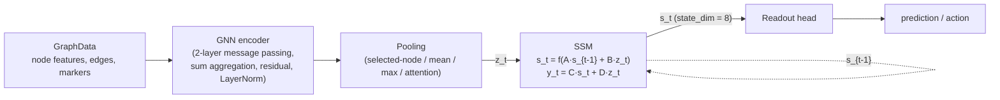

# SiR Research Dossier — Artificial Learning System (ALS)

**Project:** SiR (Synthetic Intelligence Research) · **Repository:** `artificial_cns`
**Head at time of writing:** `f901870` (main) · **Test suite:** 180 passed (2026-11-13)
**Scope:** read-only research dossier — no source code, protocol, or validated artefact was modified; no new experiments were run.

---

## Executive summary

The Artificial Learning System is a pure-PyTorch experimental platform for one specific cognitive
function: **task-dependent internal state maintenance**. A Graph Neural Network (GNN) computes a
compressed relational answer from structured input; a linear State-Space Model (SSM) holds that
answer in a small fixed-size recurrent state across tens of blind, distractor-filled steps; a
readout maps the state to behaviour. Everything is frozen under a registered reference
configuration (D800) and every headline claim is tied to a pre-registered experiment with control
arms designed to eliminate a specific alternative explanation.

The strongest experimentally established facts:

1. **Causal working memory.** The recurrent state does not merely correlate with the computed
   answer — donor-state substitution causally flips behaviour (`subst_diff_follows` = 1.000 in the
   strongest checkpoints; zero-state donation → chance), while the *evidence* (instance features)
   is absent from the state. Information survives delay in **23/23** population seeds.
2. **A reliable reference baseline.** The frozen D800 configuration (interleaved 800-episode
   schedule, adjacency task, delay 3) succeeds in **20/20 fresh seeds** — **23/23** with the
   original three kept separately visible (exact Clopper–Pearson 95% CI **[0.852, 1.000]**), with
   state-reset controls at chance in every seed.
3. **Separable stages of persistent-state learning.** Representation (the answer is in the state),
   utilisation (the readout is causally connected to it), and retention are dissociable: failures
   split into *not-computed / decays / present-but-unused*, and each stage has a registered
   intervention that works exactly where its precondition holds (capture-and-hold 3/3; applicability
   predicted in advance 3/3 vs 0/6).
4. **Two distinct acquisition routes.** Readout-side capture-and-hold (H7b) and encoder-side
   acquisition under an exactly frozen readout (B2, 3/3 data-order replications) both establish
   functional utilisation without architectural change.
5. **Deterministic execution-state continuity.** A run paused mid-training and resumed by a fresh
   process reproduces the uninterrupted trajectory bit-for-bit (registered E1 **4/4 exact**; E1b
   PASS after a recorded infrastructure re-run).
6. **A measured theory of when maintenance fails.** Retention separates into three timescales
   (perfect to delay 10; information intact but use bimodally lost at delay 30; information gone by
   delay 100 via attractor contraction), the failure mechanism is measured (displaced decision
   boundary; access oscillation = state-cloud translation across a frozen readout boundary), and
   the only working maintenance control is a direct bound on realised state displacement.

ALS has **not** demonstrated general reasoning, multi-step autonomous planning, persistent memory
across executions, autonomous goal management, or reward-driven action selection — these are absent
from the codebase, not merely unproven (§8). The D800 evidence establishes necessity of the state
for the observed behaviour, not a general working-memory faculty; all results are CPU-scale
(≤ 1,000 nodes) on one registered task family.

---

## 1. What ALS is, and why it was developed

ALS was built to answer a mechanistic question, not a leaderboard question: **why** does a hybrid
GNN+SSM architecture learn relational behaviour, and can the GNN, the SSM, and the learned weights
be shown to carry *different, separately ablatable responsibilities*? The three responsibilities
hypothesised at the outset were relational computation (GNN), temporal bridging (SSM state), and
durable associations (weights). The programme's methodological commitment is that every headline
claim must be backed by controls that kill named alternative explanations — shortcut detection,
degree statistics, instance memorisation, and information leakage at response time.

The system is deliberately small and CPU-scale. This is a feature: every experiment is
bit-reproducible, every intervention is surgical, and ~28 registered studies (§8b–§8v of
`TECHNICAL_REPORT.md`) with amendment protocols form a preserved research record including
corrections and rejections (§4.7).

## 2. Architecture

### 2.1 Modules

| Module | Path | Role |
|---|---|---|
| `GraphData` | `data/schema.py` | the single stable interface — all components communicate exclusively through it |
| Graph generators/adapters | `data/loaders.py`, `data/adapters.py` | 5 synthetic families + `GraphAdapter` seam for production data |
| Graph task generator | `data/graph_tasks.py` | connectivity/adjacency tasks with shortcut controls |
| GNN | `models/gnn.py` | message passing: mean/sum/max aggregation, residual connections, LayerNorm, node-mask silencing |
| SSM | `models/ssm.py` | discrete-time linear state-space model, spectral-radius-bounded `A`, `initial_state/step/forward/reset_state` |
| Readout | `models/readout.py` | mean/max/attention/selected-node pooling + prediction head |
| Composition | `models/gnn_ssm.py` | `GraphTemporalModel` with `forward(sequence)` and online `step(graph, state)` |
| Environments | `environment/` | cue-learning (delays, stochastic reward, reversal) + graph classification (immediate/delayed) |
| Training | `training/trainer.py` | episodic BPTT trainer; staged/interleaved curricula |
| Evaluation | `evaluation/` | ARRG, memory curves, perturbations + storage-locus, degree-preserving rewiring, state capture/decode/substitution, statistics |
| Experiments | `experiments/runner.py`, `experiments/coupling_rescue.py` | reproducible multi-seed runner, ablation matrix, all intervention arms |
| Checkpointing | `utils/checkpoints.py` | checkpoints with environment metadata; M1 execution-state contract |
| Inspection | `inspection.py` | `SystemHandle` (checkpoint mode) + `LiveSessionHandle` (live snapshot mode) |

### 2.2 Model structure and information flow



The **SSM** is the memory substrate:

```
s_t = f(A·s_{t-1} + B·z_t),  y_t = C·s_t + D·z_t
```

with `f` = tanh, `A` constrained to spectral radius ≤ 0.99 (directly for the diagonal
parameterisation; via power-iteration spectral-norm rescaling for the dense one), `state_dim = 8`
in the graph benchmark (64 in the base cue configuration), and full state-reset/masked-reset
semantics exposed for intervention. The **GNN** is pure PyTorch message passing (no PyG
dependency); `GraphTemporalModel` accepts *any* module with `forward(GraphData) -> [N, H]` as
encoder and *any* module exposing `initial_state/step` as temporal model — this compossibility is
what makes the ablation matrix cheap.

**Ablation matrix:** M1 (no GNN, no SSM), M2 (GNN only), M3 (SSM only), M4 (GNN+SSM), M5
(Transformer temporal), M6 (per-node MLP + SSM — message passing disabled).

### 2.3 Learning, training and optimisation

- **Episodic BPTT** (`Trainer.train`): each episode unrolls `sequence_length = 32` environment
  steps, accumulates losses, takes **one** Adam step per episode (lr 1e-3, no weight decay in the
  registered configuration, grad_clip configurable). State resets to `initial_state` at each
  episode boundary by design — persistence is *within-episode*.
- **Loss:** supervised cross-entropy only. Environmental reward is recorded but never enters the
  loss; a `policy_gradient_loss` exists in `training/losses.py` and is **unused** (no RL pathway is
  active).
- **Curricula:** four budget-matched conditions (A immediate-only, B delayed-only, C staged 200+200,
  D interleaved alternating single episodes). Condition D is the D800 reference schedule.
- **Two trainers, one optimizer:** immediate and delayed roles each get a `Trainer` sharing one
  Adam instance; the interleaved schedule alternates episodes between them.

### 2.4 Checkpointing, restoration and inspection

- **Model checkpoints** (`save_checkpoint`): model/optimizer/scheduler state, step, seed, config,
  environment config, and `collect_env_info()` (Python/torch/numpy versions, platform, git commit).
- **Execution-state checkpoints** (M1-a, commit `dd4907f`): `save_execution_state` additionally
  stores the **three global RNG streams** (python/numpy/torch), each named environment's serialized
  stream state (sample index, cue tensors, within-trial index, episode step, trial count, generator
  state), and per-trainer global step counters. This is what makes deterministic resume possible (§4.8).
- **Inspection** (`inspection.py`): `SystemHandle.load(path)` wraps a persisted checkpoint
  (`probe` / `inspect_state` / `summary`); `LiveSessionHandle.capture(...)` wraps an *active*
  session at an execution boundary (§5).

### 2.5 What lives where — the measured memory table (report §4)

| Information | Storage | Evidence |
|---|---|---|
| Learned cue→action / adjacency→response mappings | **Weights** | durable across delay 500+; survives state reset (immediate regime 1.000) |
| Currently-present cue bridging a gap | **SSM state** | memory-curve half-life ≈ 2 steps; full state reset → chance (0.500–0.515) |
| Computed relational answer (working memory) | **SSM state** | successful seeds: `delayed_retain` 1.000, `delayed_reset_cleared` 0.480 |
| Relational structure itself | **GNN message passing** | M1/M6 ablations at chance; degree-preserving relabelled control 1.000 |

## 3. Learning capabilities and their experimental evidence

| Capability | Verdict | Evidence (details in the evidence register) |
|---|---|---|
| Within-episode working memory | **Demonstrated (causally)** | computed answer held across 10–100 blind steps; donor-state substitution flips behaviour 1.000; counterfactual probe: update-on-new-evidence 1.000, ignore-irrelevant 1.000 (§5, §7) |
| Internal-state maintenance & modification | **Demonstrated** | state captured at fixed trial points, decoded (held-out ridge), substituted, masked-reset, reinstated — with a registered no-mutation guarantee (§8u bit-identity) |
| Adaptive learning across episodes | **Demonstrated** | weights update across the full 800-episode curriculum; D800 20/20 fresh seeds; reversal relearning measured |
| Intermediate computational-state maintenance | **Demonstrated** | delay-30 (10× trained) family: information survives 23/23, functional+behavioural 11/23 bimodally; maintenance under adaptation achievable 7/12 with real encoder adaptation (ε=0.2 budget) |
| Learning interference | **Demonstrated (as measured phenomenon)** | naive delayed-only updates destroy the untrained task: collateral damage 0.735–1.000 (§8h/§8i/§8n) |
| Interference mitigation | **Partially demonstrated** | measured mitigations: freeze partitions, rehearsal, alternating-restore (H7b full rubric 3/3), event-balanced staging, state-budget line search (7/12 adapted, 11/12 near-frozen); no mechanism fully eliminates interference — §8v shows safety bought at adaptation cost |
| State substitution has causal behavioural effects | **Demonstrated** | same-answer donation stays correct 1.000; different-answer donation **followed** 1.000; zero state → chance (§7D) |
| Reproducibility | **Demonstrated** | `verify_reproducibility.py` 12/12 exact metric matches from checkpoint+config; E1 resume 4/4 bit-exact; §8u un-instrumented control bit-identical |

## 4. Experimental evidence — the strongest validated experiments

### 4.1 D800 — the validated reference (report §6, §8h)

**Configuration (frozen):** adjacency task, bare marker features, sum aggregation, 2-layer GNN,
`state_dim` 8, generic blanks, 2,000 instances, n=100 nodes (density 0.04, delay 3 trained,
`label_mode: path`, `neg_min_distance` 3, train/test 200/50), batch 16, sequence 32, Adam lr 1e-3,
**800 interleaved episodes** (condition D).

**Methodology:** per-seed success = delayed test accuracy ≥ 0.9 on the fixed test set; evaluation
includes the registered control battery — immediate accuracy, `delayed_intact`, and
`delayed_state_reset` (state zeroed mid-delay → the answer must collapse to chance, proving the
capability is state-carried rather than weight-carried).

**Results:**

| Sample | Seeds | Delayed ≥ 0.9 | Exact 95% CI | Immediate | State reset |
|---|---|---|---|---|---|
| Original (kept visible) | 0–2 | 3/3 | [0.292, 1.000] | 1.000 | 0.493 |
| Population (fresh) | 3–22 | **20/20** | **[0.832, 1.000]** | 1.000 | 0.500 |
| Combined (power only) | 0–22 | **23/23** | **[0.852, 1.000]** | 1.000 | 0.500 |

In **every** seed the delayed state-reset probe returns to chance — the capability is state-carried
in all 23, not just the original three. Unseen-size generalization (corrected protocol): 22/23 ≥
0.985; the single outlier (seed 19, 0.560) is a reproducible **encoder edge-density calibration
gap** — degree-matched n=200 restores 1.000 — documented as a scale-generalisation limitation, not
a state-utilisation failure.

**Bounded interpretation:** reliable *within the tested regime* (n=100, density 0.04, delay 3,
2,000 instances, 800 episodes). It does not establish a schedule law beyond that regime.

**Commits/artefacts:** original D800 + GNN-frozen `7b363f3`; population study `36f4b11` (design in
`configs/experiments/d800_population.yaml`, differing from `d800_interleaved.yaml` only in
experiment name and seed list); `results/d800_population/reliability_summary.json`.

### 4.2 The state carries the *answer*, causally (report §7)

On 18 condition-seeds (`scripts/run_state_analysis.py`, commit `623fdc7`):

- **A — decodability:** held-out ridge decode of the answer ≈ 1.000 at every trial point
  (majority baseline 0.55).
- **B — answer, not evidence:** instance features absent from the state (own-class-centroid
  distance ≈ 1e-4 vs 0.38 cross-class); the code is sparse — exactly 3 of 8 dims flip sign between
  classes.
- **C — decodability ≠ use:** failed seeds split into *not-computed / decays / present-but-unused*;
  2 failed seeds carry a perfectly decodable answer yet behave at chance and fail every
  substitution control — content present but causally disconnected.
- **D — causal substitution:** same-answer donor → stays correct 1.000; different-answer donor →
  **followed** 1.000; zero state → chance; all on blank observations during the delay.

### 4.3 Separable stages and the two acquisition routes (report §8b–§8j)

| Study | Registered question | Result | Commit |
|---|---|---|---|
| H5 (§8b) | can readout-only training restore utilisation? | rescue achieved on one source with frozen state generation and unchanged state geometry; scrambled-label control clean | `769236d` |
| H6/§8d (§8c–8d) | is the rescue stable? | **no — transient**: 1.000↔chance oscillation, ~20-episode period; anti-phase gradient cosine; earlier H5 interpretation corrected in the record | `1ed225d` |
| H7/H7b (§8e–8g) | schedule-only fix? | H7 (blocked) met criteria on one source; **H7b alternating restore met the full pre-registered rubric on both phenotype-iii sources** — immediate 1.000, delayed 1.000, substitution follows 1.000, state geometry preserved (norm ratio 0.87/1.07) | `6a4da64` |
| §8i | does H7b generalise? | **capture fires exactly where the state still carries the answer at response time**: present-but-unused 3/3 full rubric (CI [0.292, 1.000]); answer-absent 0/6 (5/6 stay at chance) — applicability predictable *in advance* from a state probe | `b939367` |
| §8j (B2) | second acquisition route | encoder-side acquisition with the readout exactly frozen and uninformative: **3/3 data-order replications**, decode 0.53 → 1.000, head/C/D deltas exactly 0.000 | `0c6c532` |

The retained state is *flexible, not a rigid imprint*: successful seeds update the answer on new
evidence including answer-flipping evidence (1.000) and ignore irrelevant revision cues (1.000)
(§5 Phase D), and generalise retention to delays 10–30 (1–10× the trained delay) without training
at those delays.

### 4.4 Retention timescales and failure mechanisms (§8k–§8p)

- **§8k (delay scaling, evaluation-only, 23 checkpoints):** perfect on all three measures to delay
  10 (23/23); at delay 30 information survives 23/23 but functional and behavioural retention only
  **11/23**, bimodally, and the failures are *confidently wrong* (margin 0.74 vs 0.38); at delay 100
  information itself is gone (decode ≈ 0.53). Commit `a07f76f`.
- **§8l (geometry):** delay-30 failures are **displaced decision boundaries, not lost or rotated
  representations** — probe and readout directions aligned (cos 0.975–0.982), one class entirely
  misclassified; rotation and decay rejected. Readout-only rescue 12/12, but the joint stage erases
  it 12/12 with the readout exactly frozen. Commits `d2e1a24`, `9a81347`.
- **§8m (event balance):** 1:1 response-event balancing still collapses 0/12 within 10 pairs —
  the schedule explanation is falsified; encoder-only updates at delay 30 are destabilising in
  themselves. Commit `cc7ac05`.
- **§8n (gradient isolation):** the **delayed objective alone** collapses the rescue at episode 1
  (0/12, representational); the immediate objective alone lets 3/12 survive with decode-preserving
  boundary drift. Margin asymmetry measured at capture (delayed 0.26–0.42 vs immediate 4.4–7.1).
  Commit `5cc13e6`.
- **§8o (delay transition, evaluation-only ladder 3→100):** behavioural boundary 22–50 (bimodal),
  informational boundary 50/65 (independent); behaviour fails before information in 22/23; the code
  dies **collectively** by attractor contraction — dispersion 0.33 → 0.00015 (>2000×) at a pinned
  state norm (~2.22, tanh saturation), class-mean gap ~730× down while the scale-free ordering
  survives. Commit `74671c8`.
- **§8p (causal confirmation at the transition points):** at delay 40, behaviour 3/23 = function
  3/23 = exactly the same checkpoint set {1, 8, 15}, with information 23/23 (decode 1.000) —
  behaviour and function are **one event**; past 50 the substitution battery goes contrast-free
  because donor states anneal into near-coincidence (dispersion 0.003–0.010). Commit `ed7bb56`.

### 4.5 Maintenance under adaptation, and the access oscillation (§8q, §8u, §8v)

- **§8q (state-budget line search):** per-step line search against a cumulative state-displacement
  wall (16-instance probe batch, captured states as reference): **ε=0.2 → 7/12 full rubric with
  real adaptation** (GNN delta up to 0.119); **ε=0.05 → 11/12 but near-frozen** (7/12
  no-admissible-direction). All 24 runs keep decode = 1.000 — the representation never leaves; the
  ε=0.2 failures are **access oscillation**, not collapse. Commit `0384db7`.
- **§8u (mechanism, n=9):** the oscillation is a **state-cloud translation across a frozen readout
  boundary at an unchanged representation** (decode 1.000 at all 477 dense probes); the rule
  \|bvm\| < 0.5 separates access ON/OFF on 409/409 probes; loss and regain are the same event
  reversed. Determinism: an un-instrumented control is **bit-identical** to the instrumented run.
  Commit `0768917`.
- **§8v (online indicator, n=12):** **V1 detection PASS** — 0 violations / 1,212 probed episodes on
  all 12 checkpoints with thresholds fixed in advance; **V2 prediction FAIL** as registered
  (sensitivity 0.410, FA 0.318; measured cause: per-episode resolution — transits complete within
  one episode); **V3 prevention PASS at a cost** — zero crossings 10/12 (seed 14, previously
  unrescuable, fully protected), decode 1.000 × 1,212 probes, but adaptation < 50% of control in
  9/10 adapted checkpoints. Bottleneck measured: the 16-instance replay-batch prediction has mean
  error 5.55 bvm units vs the 0.5-unit scale (~11× over-conservative). Commits `c2406d3`
  (pre-registration), `388e452` (results); three mid-flight amendments recorded before affected
  results were used.

### 4.6 H8r — the registered rejection and its implications (§8r, §8s)

**Hypothesis (commit `10624bc`):** projecting the delayed-task encoder gradient onto the null space
of the state-Jacobian preserves the state–readout relationship, allowing **full-magnitude** encoder
adaptation without destroying persistent-state utilisation — i.e. useful admissible directions exist.

**Registered operationalisation:** J = ∂s_flat/∂θ ∈ ℝ^{128×30,025} over the response-step state of
the 16-instance probe batch (all 8 coordinates), concatenated across the three encoder groups;
projected update u = g − Jᵀ(JJᵀ)⁻¹Jg applied after gradient clipping and **before** Adam; full step
size (α=1), no budget; the same 12 captured checkpoints, 100 delayed episodes at delay 30, frozen
readout (head/C/D deltas exactly 0.000), full substitution battery; five pre-registered outcome
bands A–E; seed 14 pre-registered as a separate diagnostic case.

**Result (commit `cf6cc35`): H8r is rejected — 0/12.** Outcome E (representational collapse, decode
0.45–0.56) in 11/12; one checkpoint (seed 17) ends decode-intact (0.99) with behaviour and function
dead — the boundary-translation phenotype, reported as a registered-grid gap rather than forced
into E.

**The mechanism is measured, not asserted:**
1. The projection works exactly as designed — ‖Ju‖/‖Jg‖ = 2.7e-05 (verified before results were
   reported, commit `f396b64`); the delayed gradient is 57–96% state-changing to first order
   (random-gradient contrast 0.002) — the delayed objective *is* a state-writing objective.
2. **Adam re-magnifies the state-null residual:** realised movement is GNN delta 1.17–1.72 —
   *larger* than the unconstrained baseline (0.85–1.15). Per-coordinate second-moment normalisation
   turns a small sparse residual into ~lr-size steps along sign(u), and sign(u) is not state-null.
   Projecting the gradient does not project the update.
3. **First-order protection does not survive one step:** probe displacement 0.70 after a single
   projected step (3.5× the §8q wall), ~1.0 by episode 6 — the trajectory immediately leaves the
   linearisation's validity region. Seed 14 also collapses → its fragility is distance-to-boundary,
   not direction.

**Implications (joint with §8s, §8t):** the recorded follow-up (project the *optimizer's realised
step* post-Adam, renormalised) was registered and executed as §8s (commit `4958139` prereg,
`ba1447c` results) and **also failed 12/12** — Adam's realised step is 86–94% state-null to first
order, the projection nulls ‖J·Δθ‖ to ≤ 2.5e-3 at all 1,200 steps, yet decode collapses with a
measured **10.6× curvature discrepancy at the very first step** (linear prediction 0.0117 vs
measured displacement 0.1239). §8t then showed maintenance tolerance is **dynamical, not geometric**
(all registered geometric predictors fail; the named held-out case's fragility is invisible at
capture by 25–50×). The standing conclusion of the whole maintenance chain (§8n/§8q/§8r/§8s/§8t):

> Within this architecture, the delay-30 rescue is maintainable by **direct magnitude control of the
> realised state displacement** (§8q: 11/12 near-frozen, 7/12 with real adaptation), and **not** by
> first-order **direction** control at full magnitude — the encoder→state map's curvature at
> Adam-scale steps makes first-order guarantees trajectory-irrelevant. Direction-aware maintenance
> is closed as a negative result in both registered forms; per-instance/accepted-candidate guard
> fidelity (§8v E4) remains the open engineering question.

**Implication for SiR:** any coordinator that lets ALS adapt online while preserving a held
representation must bound the *realised* state displacement (or freeze), not trust gradient
projection; and adaptation safety trades directly against adaptation amount (§8v E3).

### 4.7 Research-history discipline (corrections preserved)

The record deliberately preserves corrected and rejected results rather than silently rewriting
them: the H5 interpretation correction (§8d), the H7 blocked-restore failure identified as a
schedule artifact (§8f), the unseen-size anomaly resolved as an evaluation-protocol defect with a
corrected controlled sweep (§8h/`fb12872`), the §8u cohort correction from a disk recount, the §8v
three mid-flight amendments, and the E1b unpinned-environment failure retained under
`results/m1_resume/E1b_seed000__resume_midep__unpinned_env_superseded/` for audit. GPU feasibility
for the Jacobian workload was benchmarked and rejected (1.7×/2.5× < the 3× threshold).

### 4.8 Deterministic resume — execution-state continuity (M1-a, report §10)

Registered **before any run** (commit `dd4907f`), scored exactly as written:

- **E1 (episode-boundary resume, seeds 0–3):** control = 400 uninterrupted episodes; treatment =
  200 episodes → `save_execution_state` → **new process** → resume → 200 episodes; PASS iff the
  four-value battery P {immediate, delayed, intact, reset} is **exactly equal** across arms.
  **V-E1 PASS 4/4** — every value bit-identical (serialized-float equality); the resume boundary is
  invisible to learning. Commit `1726fb3`.
- **E1b (mid-episode resume, seed 0, registered semantics = episode restart):** interrupt 5 steps
  into episode 200, snapshot at episode start, discard partial work, replay the episode from its
  beginning in a fresh process. **PASS** after a recorded infrastructure re-run: the first attempt
  failed because the launcher omitted the pinned BLAS environment (`OMP_NUM_THREADS=1`,
  `MKL_NUM_THREADS=1`) — torch multi-threaded reductions reorder float summations; re-running under
  the pin yields an episode-start snapshot **bit-identical** to the boundary checkpoint. The
  superseded arm's artifacts are retained for audit; no criterion or semantics changed.
  Commits `5f48d3b`, `1726fb3`.
- **M1-b (query API):** `SystemHandle` (checkpoint mode) unit criterion met; full suite 165 green
  at that point. Recorded limitation: legacy checkpoints do not embed input dimensions.
- **M1-c (progress-field probe, 8 fresh seeds):** **PC1 — trial phase is decodable from the
  recurrent state, 8/8** (multiclass ridge CV accuracy 0.800–0.880 vs majority 0.250; delta
  +0.55…+0.63 over the registered ≥ 0.15 threshold, ~3.7× at the worst seed). **PC2 — phase is
  decodable but not causally used (2/8)**: substituting a phase-mismatched, content-correct donor
  changes the prediction *less* than a phase-matched, content-altered donor in 6/8 seeds — the
  response is driven by **what** the state carries (the computed answer), not by **when** in the
  trial it sits. Phase in the state is a **correlate, not a cause**. Both terminal outcomes are
  registered successes of the probe. Commit `64e3978`; raw captured states retained per seed
  (`results/m1_progress/P_seedSSS/delayed_states.pt`).

## 5. State inspection and continuity — `ALS-M1-LIVE-INSPECT/1.0`

Delivered at commit `55d7086`; 15/15 live-inspection tests, full suite **180 passed**
(`docs/ALS_M1_LIVE_INSPECTION_TEST_REPORT.md`); Hybrid-facing contract in
`docs/ALS_M1_HYBRID_INTERFACE_CONTRACT.md`.

### 5.1 Snapshot semantics and detached capture

- An active ALS session is a set of in-memory objects (one `GraphTemporalModel`, one shared
  optimizer, two `Trainer`s, two environments), quiescent between `train()` calls. **Every point
  between two trainer calls is an execution boundary**; the registered mid-episode pause
  (`pause_after_steps`) is the second supported boundary type.
- `LiveSessionHandle.capture(model, optimizer, trainers, envs, session_id)` performs a
  `copy.deepcopy` of the model, sets the **copy** to eval mode, reads (never writes)
  optimizer/trainer/environment metadata, and records a deterministic **`parameter_digest`**
  (sha256 over the sorted state dict) identifying the captured execution version.
- The isolation guarantee is **structural, not behavioural**: the measurement helpers' `eval()/
  train()` mode flips operate on the copy, so no future change to them can leak into the live
  session. The alternative (in-place inspection of the live module) was considered and rejected —
  it flips the live module's `training` flag and cannot honestly claim bit-read-only.
- Serialization→reload (checkpoint mode) remains available; a cross-mode agreement test proves the
  two paths measure identically.

### 5.2 Query capabilities and parameter digest

Every response carries `supported`, `mode` (`checkpoint` | `live_snapshot` | `captured_state`), and
`contract_version` — a coordinator always knows which surface it reads. Supported queries:
`summary` (session/step/digest/parameter count/optimizer & env presence; explicitly carries
*"frozen live snapshot; not a persistent-memory claim"*), `probe` (task accuracy),
`inspect_state` (trial-point state capture + held-out ridge decode + state norms),
`state_digest` (read-only canary), `availability`. Unknown queries and missing arguments return a
uniform unsupported shape; they never raise.

### 5.3 Staleness and determinism

- The handle is immutable; queries reflect the **capture point** and say so. The live session may
  continue training after capture (`test_handle_frozen_while_live_advances`); `captured_digest` is
  the identity of the inspected execution version; re-capture creates a new version.
- All 15 tests are **exact** bit/hash comparisons (every inspected quantity is deterministic on
  CPU). Verified: after capture plus a full query battery, parameters (sha256), optimizer state,
  trainer counters, environment streams and RNG streams are **bit-identical**, and subsequent
  training matches a never-inspected twin bit-for-bit.

### 5.4 What can and cannot be restored — live inspection vs checkpoint restoration

| | Live inspection (`LiveSessionHandle`) | Checkpoint restoration (`save_execution_state`/load) |
|---|---|---|
| Purpose | **observability only** — read-only view for a coordinator | **continuity** — resume training exactly |
| Restores | nothing; queries a frozen copy | parameters, optimizer (Adam moments), scheduler, all three RNG streams, environment stream states, step counters |
| Boundary semantics | capture at any execution boundary | episode boundary (E1) or mid-episode via **registered episode-restart** (E1b — partial steps discarded, episode replayed) |
| Guarantees | bit-identical to the never-inspected twin | bit-identical trajectory to the uninterrupted run (4/4 registered) |
| Cannot | mutate, advance, or refresh the live session | serialize the live autograd graph (why mid-episode is replay, not continuation); persist a *live* handle |

Live inspection does **not** establish persistent memory across executions — it is the observability
half; the checkpoint/execution-state machinery is the continuity half. They compose
(capture + `save_execution_state` at boundaries, both verified).

## 6. Limitations — what ALS has NOT demonstrated

1. **General reasoning.** No compositional multi-hop tasks, no reasoning probes registered;
   multi-step *computation* (delay+1 trial structure) is demonstrated, multi-step *reasoning* is not.
2. **Multi-step autonomous planning.** Action selection is `argmax` over logits; no planner, goal
   store, or arbitration exists in the codebase.
3. **Persistent memory across executions.** State resets per episode by design; there is no
   cross-run memory store. Checkpoints preserve *weights/execution state*, which is engineering
   continuity, not episodic persistence.
4. **Autonomous goal management.** No goal/progress variables exist anywhere; M1-c shows trial
   phase is a *correlate* in the state, not a used representation.
5. **Reward-driven action selection.** Reward is recorded, never in the loss; `policy_gradient_loss`
   exists and is unused. (Exception: nothing qualifies — no separate evidence exists.)
6. **Complete deterministic mid-episode recovery.** The registered contract is episode restart
   (partial steps discarded and replayed); continuing the exact partial autograd state is not
   implemented and is argued (recorded) to be impossible without changing backward computation.
7. **General intelligence.** ALS is a validated research substrate for one cognitive function in
   one registered task family at CPU scale; nothing here licenses a broader inference.

Scope caveats carried from the report: the state-reset result establishes *necessity of the state*,
not a general working-memory faculty; results are 2–4 seeds per condition in most studies
(the flagship reliability claims carry their own population runs); one task family; all
CPU-scale (≤ 1,000 nodes, ≤ 10k instances).

## 7. Contribution to SiR

ALS's intended role in the unified architecture: the **internal-state / adaptive-maintenance
subsystem** — working memory and gated adaptation.

| Tier | Capability | Basis |
|---|---|---|
| **Experimentally demonstrated today** | Causal within-episode working memory (state carries and causally uses the computed answer); structured relational computation (GNN, with degree-preserving controls); measured adaptation with a known tolerance profile and interference costs; deterministic execution-state resume (4/4 bit-exact); read-only live inspection of an active session; a reliable reference baseline (23/23) | §4, §5 |
| **Available through interfaces** | `SystemHandle` / `LiveSessionHandle` (probe, inspect_state, summary, digests, uniform unsupported handling) for a Hybrid coordinator to observe an active ALS session without disturbing it; `save_execution_state`/load for pause/resume across processes; the \|bvm\| access instrument (detection PASS) as a safety monitor for any coordinator-driven adaptation | `ALS_M1_HYBRID_INTERFACE_CONTRACT.md` |
| **Proposed future capabilities** | Per-instance/accepted-candidate guard fidelity (§8v E4) to get prevention without the adaptation freeze; long-delay maintenance beyond the measured band; cross-execution persistent memory (needs a store that does not exist today); progress/goal representation that is causally used (M1-c shows the current phase signal is not used) | registered follow-ups, open items |
| **Still requiring research** | Reward-driven action selection (no RL pathway active); multi-step compositional reasoning; autonomous planning/goal management; scale generalisation beyond the tested regime (one seed's edge-density calibration gap is the documented data point) | §6 |

Interfaces already delivered to the integration layer (commits `55d7086`, `f901870`): contract
`ALS-M1-LIVE-INSPECT/1.0` with schemas, lifecycle semantics, read-only guarantee, and explicit
out-of-scope disclaimers.

## 8. Reproduction

Every number in this dossier traces to `results/<experiment>/summary.json` or the registered
analyses cited in the evidence register; each experiment directory contains the exact `config.yaml`,
per-seed summaries, raw CSVs, and checkpoints with environment metadata. `scripts/verify_reproducibility.py`
regenerates published metrics from committed checkpoints + configs (12/12 exact matches). Unit suite:
**180 passed** (2026-11-13). Full methodological detail: `TECHNICAL_REPORT.md` (§1–§10,
21 registered experiment sections §8b–§8v). The pending Stage 3 v2 experiment was deliberately not
inspected; nothing in this dossier assumes its outcome.
